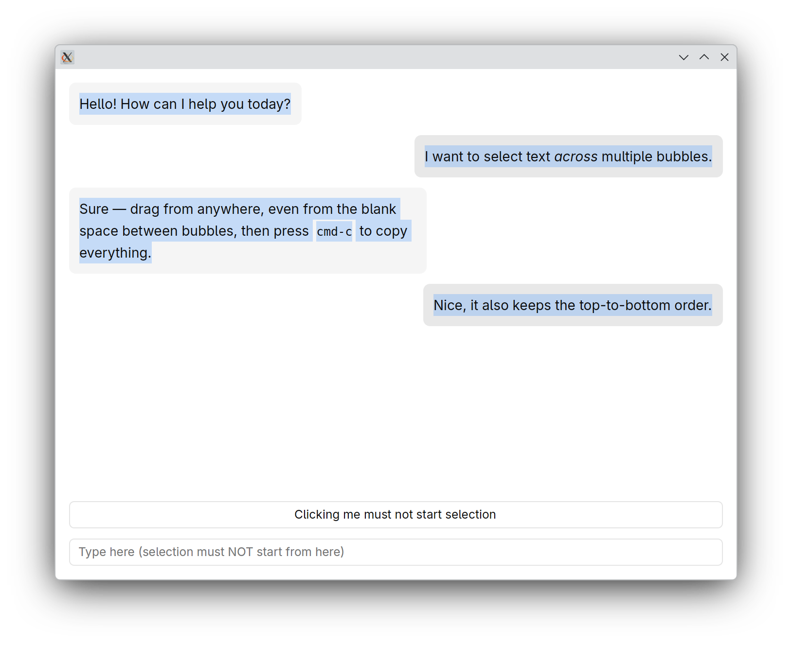
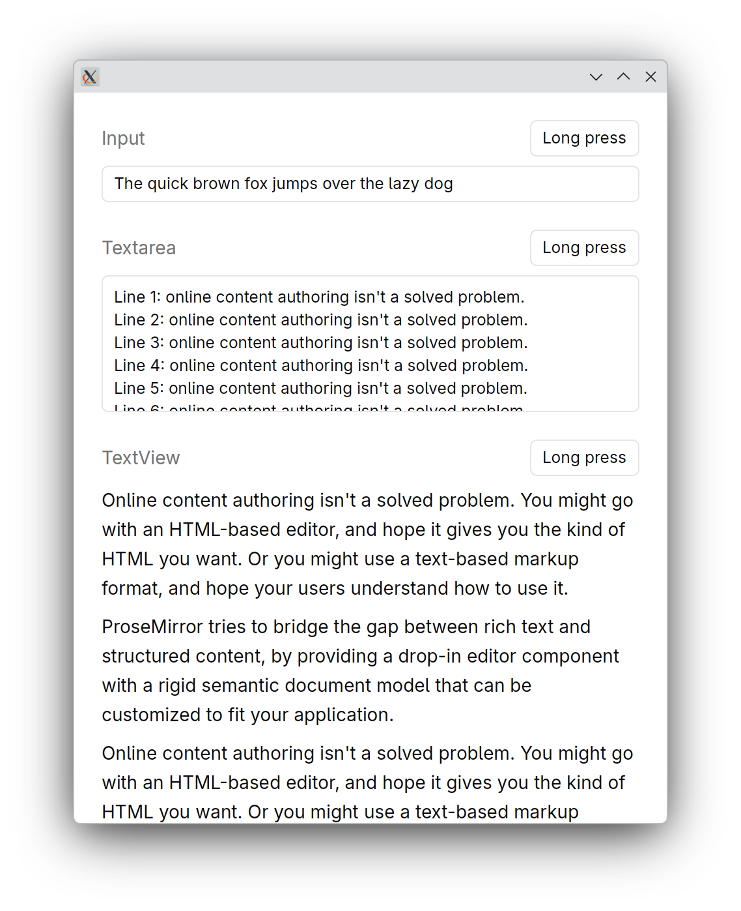
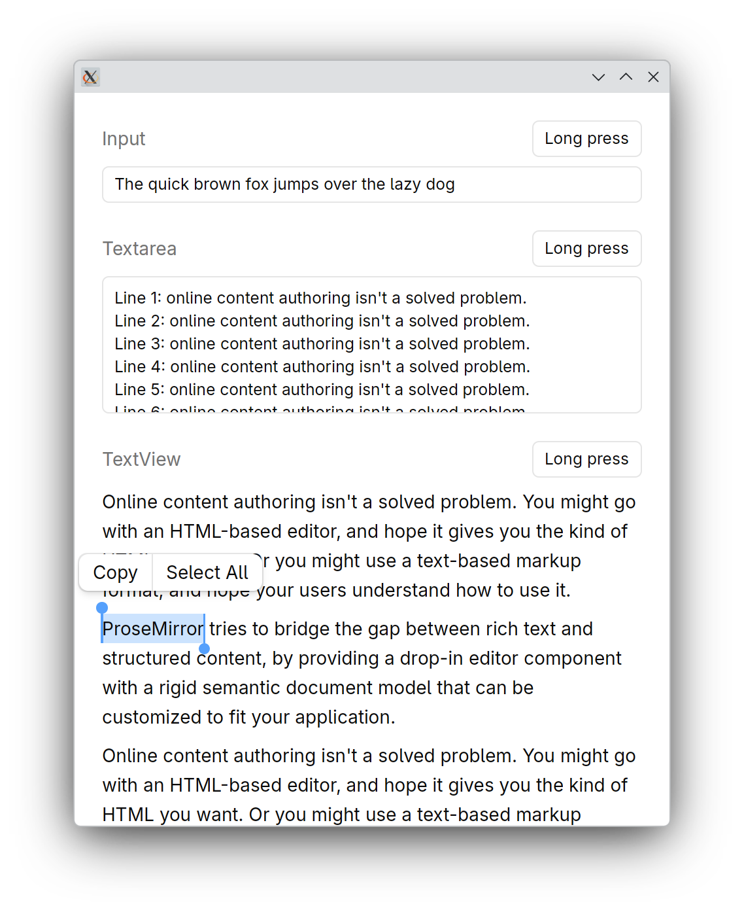
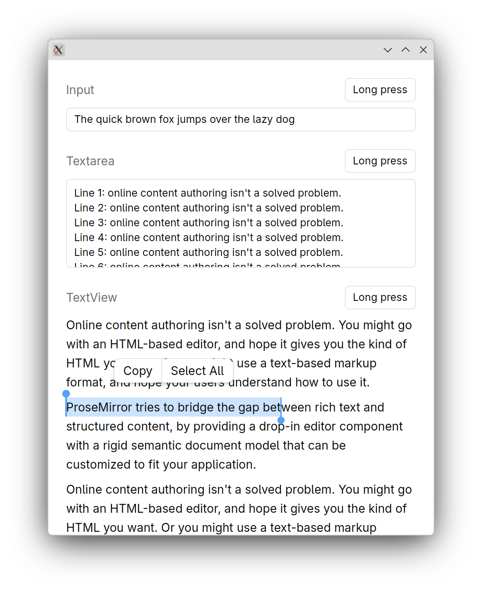
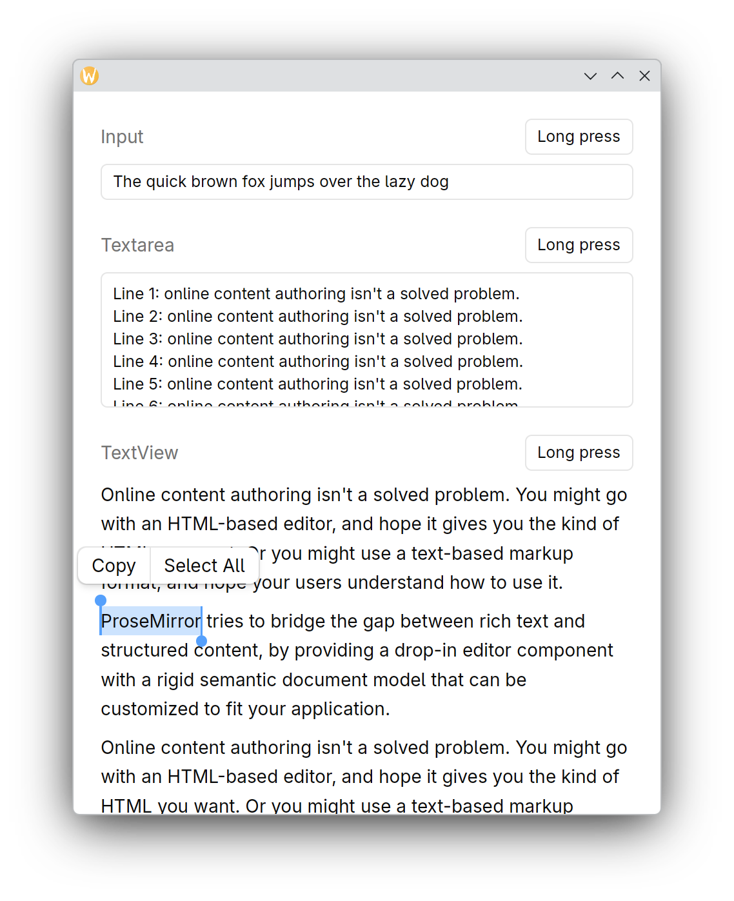
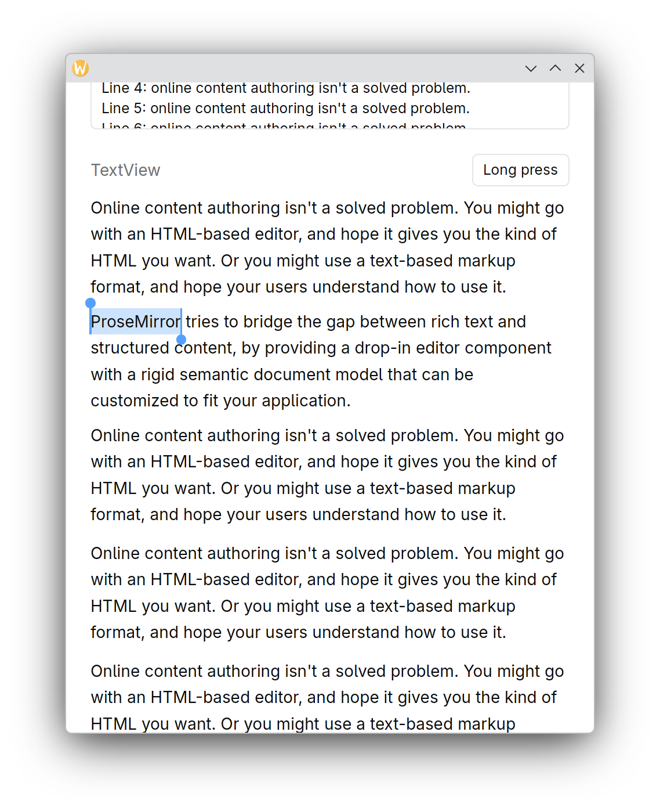
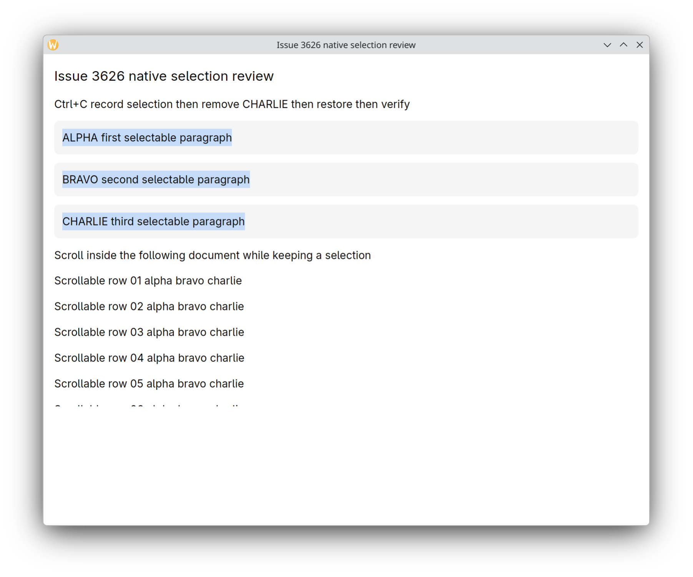
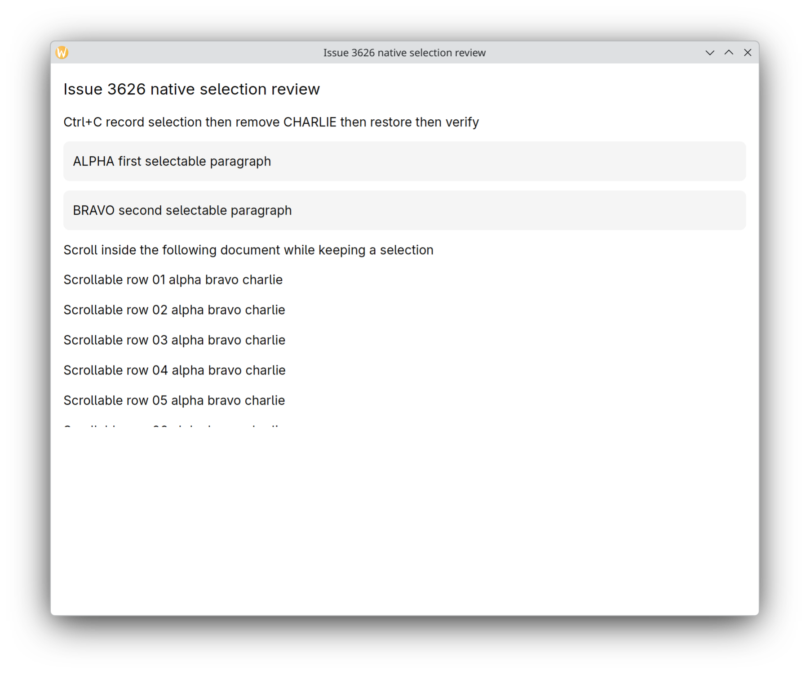
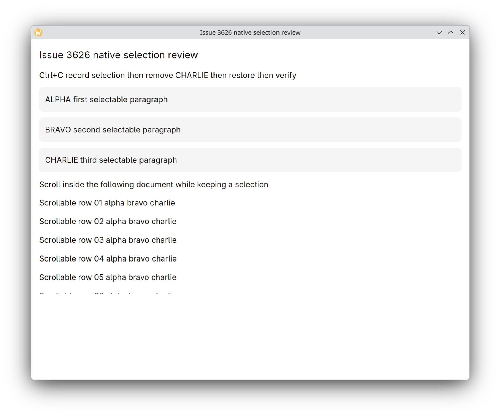

# Issue 3626 Patch Review and Native Acceptance Record

2026-10-25 · fix/3626-text-selection-frame-publication

## Purpose and approach

The patch addresses unrelated view redraws during GPUI Fast text selection and quadratic participant publication. Its four Base files separate geometry registration from publication and preserve order across retained frames, which is a reasonable approach for the reported issue and retains existing imports and call sites.

## Findings

Finding: line-by-line review has not identified a confirmed blocking code defect. The complete patch and adjacent call paths were reviewed; no further production edits were made. Native acceptance status below remains a limitation.

| Area | Review |
| --- | --- |
| Registration and publication | Registration updates geometry through a shared-state read and computes only its own snapshot; one deferred publication per frame avoids an N-by-N scan. |
| Retained views and order | ParticipantPaintOrder retains order between frames; complete frames commit order, while incomplete topology changes request one recovery refresh. Explicit document order remains caller supplied. |
| Unmount and lifecycle | Weak entities, rendered markers and generations distinguish cached participants from departed elements. Endpoint retirement clears the shared gesture and departed participant state. |
| Events and copy caches | Quiet snapshot changes immediately invalidate copy projections; draw_changed merges paint-time changes. End-of-frame updates are collected before notification, avoiding window-state writes inside the registration scan. |
| Touch and scroll | Touch-edge and held-cursor updates are deferred. Self-scroll changes projections through scroll_offset without rebuilding document order. |
| Public API and layers | Changes stay in Base behavior. No exported items are added or removed. The existing hidden public begin_selection_frame signature remains as a compatibility no-op; new ordering state and methods are internal. |
| Test review | Four new cases exercise retained TextViews, mouse events and copy queries, covering unrelated renders, linear visits, scroll and ordering/unmount. snapshot_visits exists only under cfg(test). |

## Validation and limitations

- Clippy with deny warnings passed for the Base Fast library; see [clippy.log](clippy.log).
- Patch whitespace and reverse-application checks passed; the same four production files remain modified.
- Existing validation: 56 Fast selection tests, 53 regular GPUI selection tests and 78 Kit related integration cases passed.
- Full suite comparison: 1469 passed and 23 failed after the fix; all 23 failure names also occur before it. See [performance evidence](../performance/index.en.md).

## Native desktop acceptance

**Native desktop acceptance is complete with no new confirmed blockers.** Authorized KDE RemoteDesktop EIS input drove real XWayland and Wayland application windows. Spectacle captures below show actual desktop windows, not offscreen renders.

- Forward and reverse cross-text drags produced exactly matching clipboard text in document order.
- The native demo Long press button showed touch selection handles and menu. Pointer handle expansion, menu Copy and Ctrl+C produced matching text.
- The native Wayland page visibly scrolled; handles and selection moved with the text, and clipboard text stayed ProseMirror.
- Keyboard-triggered endpoint removal retired the three-paragraph selection. Remounting the retained entity did not restore it; both subsequent probes report has_selection=false.

The temporary fixture binds Ctrl+C to record then remove, restore and verify the endpoint; that fixture does not test clipboard copying. Clipboard behavior was verified in the unchanged examples. [Fixture](selection_native_review.rs) · [Build log](native-fixture-build.log) · [Acceptance record](acceptance.json)

## Actual desktop screenshots

### Forward cross-text selection

### Reverse cross-text selection

### Touch selection menu and handles

### Handle expansion

### Before Wayland scrolling

### Selection and handles after scrolling

### Selected endpoint before removal

### Endpoint removed

### Endpoint remounted without resurrecting selection

## Limitations

Physical touchscreen input was not validated. The EIS touch long press did not produce a confirmed selection and is not counted as passing. Only native desktop operations of the demo Long press entry, selection handles and menu are counted as passed. The initial XWayland wheel operation did not visibly move the page; native Wayland scrolling was subsequently verified with visible movement and clipboard evidence. macOS and Windows were not tested.

The line-by-line review, Clippy, earlier regression/integration results and native desktop acceptance support opening a PR for maintainer review. Disclose the 23 existing full-suite failures, platform limits, CPU timing methodology and AI involvement. No production code was added during review.
