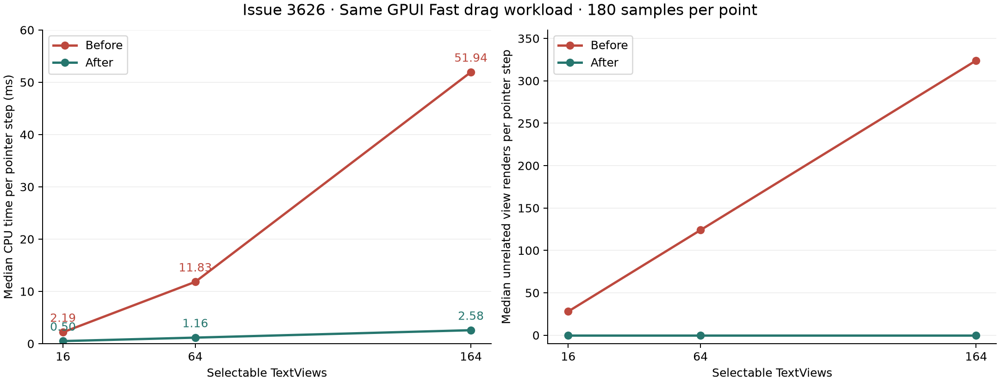
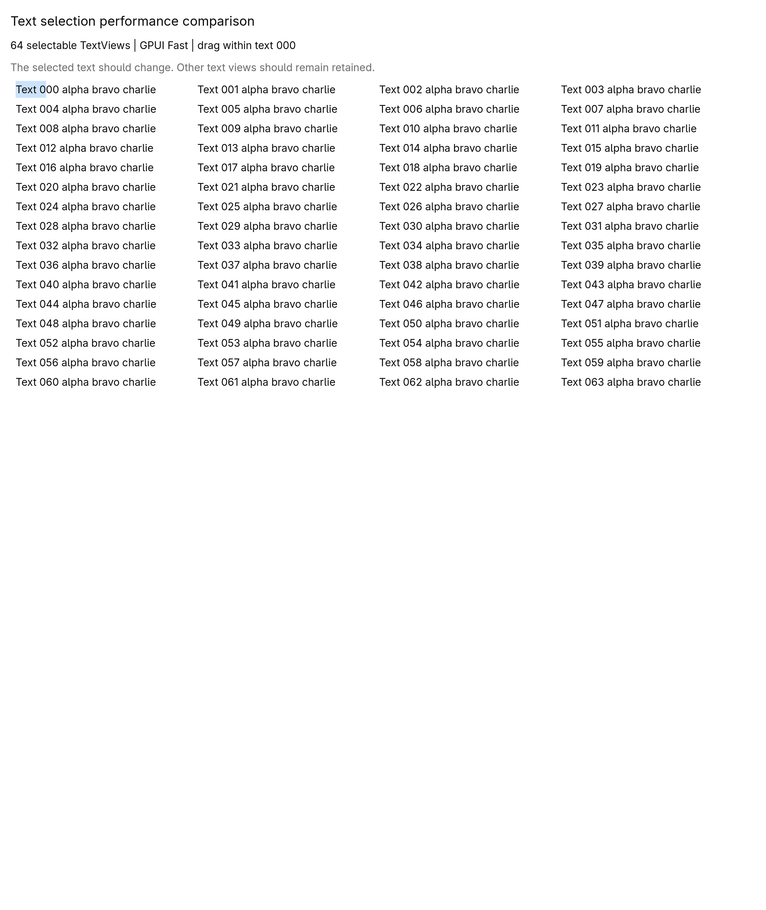

# Issue 3626 Performance and Screenshot Comparison

With 164 TextViews, median CPU time per pointer step falls from 51.94 ms to 2.58 ms, approximately 20.2 times faster. Median unrelated view renders fall from 324 to zero.

2026-10-25 · Linux x86_64 · rustc 1.98.0 · GPUI Fast 0.1.10

## Performance



| TextViews | Before median CPU time | After median CPU time | Speed ratio | Median unrelated renders |
| --- | --- | --- | --- | --- |
| 16 | 2.19 ms | 0.50 ms | 4.4× | 28 → 0 |
| 64 | 11.83 ms | 1.16 ms | 10.2× | 124 → 0 |
| 164 | 51.94 ms | 2.58 ms | 20.2× | 324 → 0 |

## Before and after screenshots

64 TextViews and identical final pointer position. Click for full-resolution images.

Before



After


## Method

The same fixture uses GPUI Fast, a light theme and a fixed 1180 × 1400 logical-pixel window with four columns. Only the first TextView is selected. For each size, three trials each warm up for 10 moves and record 60 moves, giving 180 samples per version per size. Each identical pointer step dispatches a real mouse event, calls window.draw and runs pending tasks until parked. Timing covers input dispatch, drawing and deferred processing. Counters count each text view's render calls. No forced full-window refresh is used.

## Scope and interpretation

These are local Linux x86_64 dev-build CPU measurements; GPUI dependencies retain the repository's opt-level 3 overrides. One input step can cause multiple draws, so per-step render counts are not participants per frame. Timing excludes screenshot readback, GPU completion and display presentation. It is not the macOS frame metric from the original issue and must not be converted to FPS. Screenshots use real platform fonts and GPUI GPU offscreen rendering, not a mockup or desktop capture. The two screenshot files are byte-identical: selection appearance is preserved in this scenario, while counters and timings show the performance change.

## Raw evidence

[before.csv](before.csv) · [after.csv](after.csv) · [summary.json](summary.json) · [before-run.log](before-run.log) · [after-run.log](after-run.log) · [selection_3626.rs](selection_3626.rs)

Local replay commands

```bash
/home/luren/Code/rust/gpui-component/target/3626/before-evidence before /home/luren/Desktop/3626-test-results/performance
/home/luren/Code/rust/gpui-component/target/3626/after-evidence after /home/luren/Desktop/3626-test-results/performance
```

[Native desktop acceptance and real window screenshots](../native-review/index.en.md)
